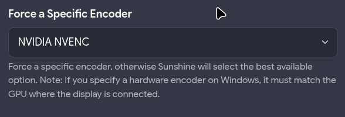

~~不可能在ipad上推流玩osu!，绝对不行！（似乎可行？）~~

sunshine/moonlight

## 网络延迟

某鱼上五块的 lightning 转百兆网口 5¥

一条功能正常的网线 5¥

~~一台能跑osu的电脑和屏幕正常的平板~~

按自己平板手机把lightning口换成别的 micro-usb usb-c 30pin(?)

## 画面处理延迟

以下适用于n卡

webui -- advanced



arch官方仓库的sunshine构建不带cuda 为减少各类编码开支 使用官方提供的仓库

```
[lizardbyte]
SigLevel = Optional
Server = https://github.com/LizardByte/pacman-repo/releases/latest/download
```

## 结果


~~比wine延迟低(笑)~~